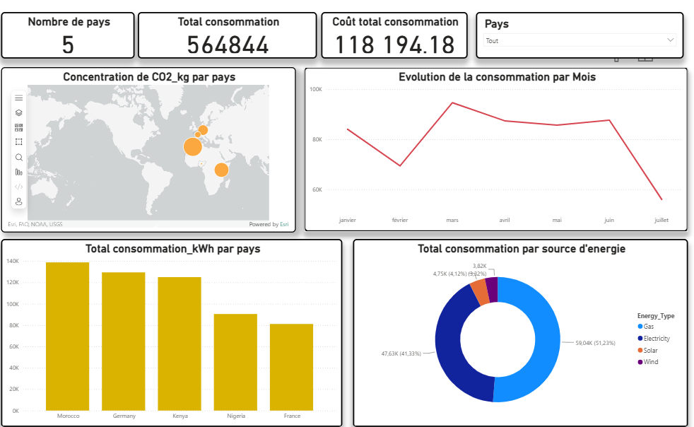
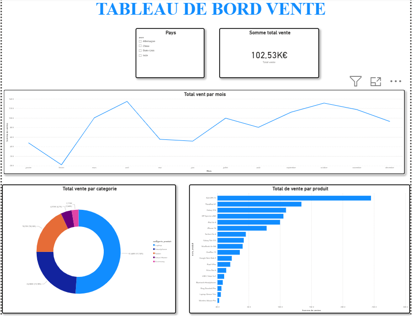

# Power BI Dashboards — Sales, Distribution and Energy

> Four interactive reports built in Power BI Desktop on fictional or public practice data.

## Overview

| Report | Business question | What it contains |
|---|---|---|
| **Distribution** (`Fichier distribution cours Power BI traité.pbix`) | How are sales distributed across products, customers and regions? | 5 pages: an overview with 6 KPI cards, comparison charts, a treemap, a trend view with a slicer, and a map |
| **2026 Sales** (`Vente_TRS_2026.pbit`) | Which countries and categories drive sales in 2026? | 4 KPI cards, map, monthly trend, category breakdown (donut charts, treemap), measures for number of sales, countries and categories |
| **Daily Sales** (`tableau_bord_vente_jour1.pbit`) | How do orders evolve day by day, and who are the customers? | Customers and orders tables linked by a relationship, trend line, bar and donut charts, slicer |
| **Green Pulse — Energy** (`Tableau de bore_Green_Pulse.pbit`) | How does energy consumption and its cost vary by country over time? | KPI cards (total consumption, total cost, number of countries), map, trend, breakdown, slicer |

## Screenshots

### Green Pulse — Energy consumption

- **5 countries**, **564,844 kWh** consumed for a total cost of **118,194**
- **Gas (51%) and electricity (41%)** make up over 90% of consumption; solar and wind remain below 8% together
- **Morocco** is the largest consumer, ahead of Germany and Kenya; consumption peaks in March and falls sharply in July

### Daily Sales

- **Total sales: €102.5K**, with a low point in February and peaks in April and October
- **Laptops account for about half of sales (51%)**, followed by smartphones (24%) and tablets (18%)
- **Dell XPS 15** is by far the best-selling product
- Sales can be filtered by country (Germany, China, United States, India)

## Approach

1. Imported the data with **Power Query**.
2. Built the **data model** (relationships between tables where needed).
3. Wrote **DAX measures** for the KPIs (totals, counts of sales, countries and categories).
4. Designed each report around one business question: KPI cards first, then trend, breakdown and map, with slicers for filtering.

## Skills demonstrated

Power BI Desktop · Power Query · data modelling · DAX measures · KPI cards · maps · slicers · report design

## How to open

Download a `.pbix` or `.pbit` file and open it with [Power BI Desktop](https://www.microsoft.com/power-bi/desktop) (free). A `.pbit` is a template: Power BI asks for the data source when you open it.

🇫🇷 Version française

Quatre rapports interactifs réalisés dans **Power BI Desktop** :

- **Distribution** : 5 pages (vue d'ensemble avec 6 indicateurs, comparaisons, treemap, évolution avec segment, carte)
- **Ventes 2026** : indicateurs, carte, évolution mensuelle, répartition par catégorie
- **Ventes journalières** : modèle clients / commandes relié, évolution et répartition des commandes
- **Green Pulse** : consommation d'énergie et coût par pays, carte et évolution. 5 pays, 564 844 kWh ; le gaz (51 %) et l'électricité (41 %) dominent ; le Maroc est le plus gros consommateur
- Dans les ventes, les **ordinateurs portables** représentent environ la moitié du chiffre d'affaires, et le **Dell XPS 15** est le produit le plus vendu

Compétences : Power Query, modélisation, mesures DAX, cartes, segments, conception de rapports.

## Author

**Nanga Alexis Camara** — Junior Data Analyst
[Portfolio](https://portfolio-nanga.vercel.app) · [LinkedIn](https://www.linkedin.com/in/nanga-alexis-camara-292045242)
